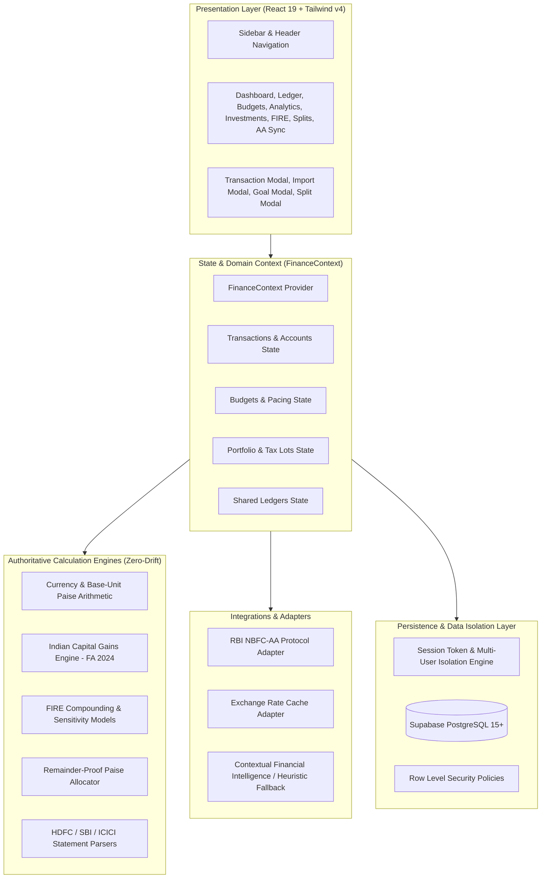

# FINN Architecture & System Design Document

This document outlines the software architecture, design principles, data flow pipelines, and technical boundaries of the FINN personal finance management application.

---

## 1. High-Level Architecture

FINN utilizes a multi-layered, client-first architecture designed for rapid feedback, high reliability, deterministic financial calculations, and secure backend synchronization.



---

## 2. Layer Descriptions

### A. Presentation Layer (`src/views/` & `src/components/`)
- Built with React 19 functional components utilizing strict TypeScript typing.
- Styling strictly adheres to the **FINN Design Directive**: restrained warm neutral backgrounds, forest green brand accents, subtle neutral borders, tabular figures (`font-variant-numeric: tabular-nums`), and zero decorative gradients or neon cards.
- Charting powered by Recharts with custom tooltips, neutral axes, and accessible contrast ratios.

### B. Domain & State Management Layer (`src/context/FinanceContext.tsx`)
The centralized `FinanceContext` provides an immutable-like single source of truth:
- **Metrics Computation**: Dynamically calculates Net Worth, Liquid Cash, Inflows, Outflows, Net Savings, and Savings Rate.
- **Double-Entry Enforcement**:
  - `income`: Increases receiving account balance; adds to monthly inflows.
  - `expense`: Decreases paying account balance; adds to monthly outflows.
  - `transfer`: Deducts from source account and increments destination account. **Strictly neutral** to net cash flow (inflows = 0, outflows = 0).
  - `investment_contribution`: Moves liquid cash into an investment account. Does not treat the capital deployment as a consumed living expense.
  - `refund`: Linked to original expense; reduces gross monthly disbursements rather than falsely inflating income.

### C. Authoritative Calculation Engines (`src/utils/`)
All financial arithmetic is decoupled from UI components to enable automated unit testing:
1. **`currency.ts`**:
   - Converts decimal figures into integer paise (`Math.round(amount * 100)`).
   - Formats Indian numbers (`12,34,567.89`) and shorthand designations (Lakhs `₹12.50 L`, Crores `₹1.50 Cr`).
   - Sanitizes text inputs against CSV Formula Injection (`=`, `+`, `-`, `@`).
2. **`investmentCalculator.ts`**:
   - Maintains weighted-average cost basis across buy lots.
   - Calculates partial sales proceeds, realized capital gains, and remaining unit basis.
   - Applies Indian Finance Act 2024 tax rules (STCG @ 20%, LTCG @ 12.5% exceeding ₹1,25,000 exemption).
3. **`fireCalculator.ts`**:
   - Projects financial independence horizons across nominal and inflation-adjusted real returns.
   - Computes 3 sensitivity scenarios (Base, Conservative, Accelerated).
4. **`splitCalculator.ts`**:
   - Guarantees exact remainder distribution down to the single paise.
   - Generates pairwise settlement matrices.

### D. Bank & Statement Ingestion Pipeline (`src/integrations/`)
- Ingests raw CSV statements from major Indian banks (HDFC Bank, State Bank of India, ICICI Bank).
- Computes SHA-256 / composite string signatures (`${date}_${amount}_${type}_${normalizedDescription}`) to detect and ignore duplicate imports.
- Integrates RBI Account Aggregator protocol models (Consent Management, Financial Information Provider discovery, and secure payload decryption).

---

## 3. Data Flow Pipelines

### A. Transaction Ingestion to Metric Propagation
```
User Enters Transaction OR Ingests CSV Statement
   │
   ▼
Sanitization & Validation (Zod / Schema Validation)
   │
   ▼
Signature Verification (Duplicate Detection Filter)
   │
   ▼
Ledger Mutation (FinanceContext State Dispatch)
   │
   ├─► Account Balances Updated (Source / Target)
   ├─► Monthly Inflows / Outflows Recomputed
   ├─► Budget Category Actuals Recalculated
   ├─► Budget Pacing Index Evaluated
   └─► Net Worth Trajectory Updated
```

### B. Multi-Currency Normalization Flow
- Primary reporting currency defaults to `INR (₹)`.
- Non-base currency transactions (e.g. `USD`, `EUR`, `GBP`, `SGD`, `AED`) are normalized using cached interbank exchange rates.
- Preserves native currency figures in the database record alongside converted base amounts for auditability.

---

## 4. Architectural Boundaries & Security

| Layer | Responsibility | Isolation Mechanism |
| :--- | :--- | :--- |
| **Browser Client** | UI rendering, user interaction, client-side validation | Sandboxed DOM, sanitized markdown rendering, no private API secrets |
| **Integrations** | Bank statement parsing, AA consent workflows, FX feeds | Client-side cryptographic duplicate hashing, proxyable API adapters |
| **Database** | Permanent record storage, relational integrity | PostgreSQL foreign keys, check constraints, Row Level Security (RLS) |
| **Auth & Identity** | Multi-tenant isolation | UUID-bound JWT authentication, session expiration timers |
