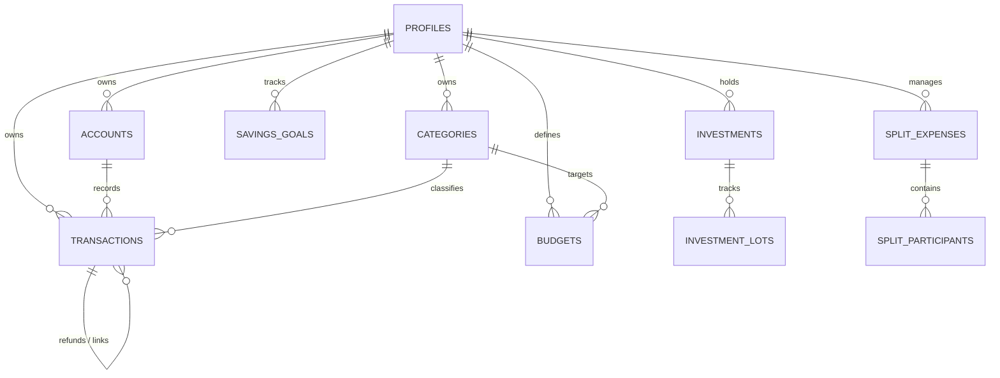

# FINN Database Schema & Persistence Architecture

This document specifies the PostgreSQL relational database schema, integrity constraints, indexing strategy, and Row Level Security (RLS) policies implemented for FINN.

The migration file is located at: [`supabase/migrations/00001_initial_schema.sql`](file:///c:/Users/chana/Desktop/Finn/supabase/migrations/00001_initial_schema.sql).

---

## 1. Schema Design Principles

1. **Exact Numerical Precision**:
   - All financial amounts use `NUMERIC(15, 2)` or `NUMERIC(18, 4)`. Floating-point types (`REAL`, `FLOAT`, `DOUBLE PRECISION`) are prohibited to eliminate binary representation errors in ledger totals.
2. **Multi-Tenant Isolation via Row Level Security**:
   - Every user-owned table includes a `user_id UUID NOT NULL REFERENCES auth.users(id) ON DELETE CASCADE`.
   - PostgreSQL Row Level Security (RLS) is forced enabled on all tables.
3. **Auditing & Timestamps**:
   - Tables contain `created_at TIMESTAMPTZ DEFAULT NOW()` and `updated_at TIMESTAMPTZ DEFAULT NOW()`.
   - Critical operations trigger immutable entries in the `audit_logs` table.

---

## 2. Entity-Relationship Overview



---

## 3. Core Table Definitions

### A. `profiles`
User profile and localization preferences.
| Column | Type | Constraints | Description |
| :--- | :--- | :--- | :--- |
| `id` | `UUID` | Primary Key, References `auth.users(id)` | User identity |
| `email` | `TEXT` | NOT NULL, UNIQUE | User email address |
| `full_name` | `TEXT` | | User display name |
| `default_currency`| `VARCHAR(3)` | NOT NULL, DEFAULT `'INR'` | Primary reporting currency |
| `locale` | `VARCHAR(10)` | NOT NULL, DEFAULT `'en-IN'` | Locale for date/number formatting |
| `theme_preference`| `VARCHAR(10)` | DEFAULT `'system'` | `'light'`, `'dark'`, `'system'` |
| `created_at` | `TIMESTAMPTZ`| DEFAULT `NOW()` | Registration timestamp |

### B. `accounts`
Financial institutions, bank accounts, demat accounts, credit lines, and cash reserves.
| Column | Type | Constraints | Description |
| :--- | :--- | :--- | :--- |
| `id` | `UUID` | Primary Key, DEFAULT `gen_random_uuid()` | Unique account identifier |
| `user_id` | `UUID` | Foreign Key -> `auth.users(id)` | Account owner |
| `name` | `TEXT` | NOT NULL | e.g. "HDFC Salary Account", "Zerodha Demat" |
| `account_type` | `VARCHAR(30)` | NOT NULL | `'checking'`, `'savings'`, `'credit'`, `'investment'`, `'loan'`, `'cash'` |
| `currency` | `VARCHAR(3)` | NOT NULL, DEFAULT `'INR'` | Native account denomination |
| `balance` | `NUMERIC(15,2)`| NOT NULL, DEFAULT `0.00` | Current verified balance |
| `institution_name`| `TEXT` | | Bank / Brokerage name |
| `account_number_mask` | `VARCHAR(10)` | | Last 4 digits (e.g. `*4092`) |
| `is_active` | `BOOLEAN` | DEFAULT `TRUE` | Soft-delete / archival flag |

### C. `transactions`
The immutable double-entry ledger of all financial activities.
| Column | Type | Constraints | Description |
| :--- | :--- | :--- | :--- |
| `id` | `UUID` | Primary Key, DEFAULT `gen_random_uuid()` | Transaction identifier |
| `user_id` | `UUID` | Foreign Key -> `auth.users(id)` | Ledger owner |
| `account_id` | `UUID` | Foreign Key -> `accounts(id)` | Source/paying account |
| `destination_account_id` | `UUID` | Foreign Key -> `accounts(id)` | Target account (for transfers) |
| `category_id` | `UUID` | Foreign Key -> `categories(id)` | Expense/income category |
| `amount` | `NUMERIC(15,2)`| NOT NULL | Magnitude in transaction currency |
| `currency` | `VARCHAR(3)` | NOT NULL, DEFAULT `'INR'` | Currency code |
| `exchange_rate` | `NUMERIC(12,6)`| DEFAULT `1.0` | Exchange rate to base currency |
| `base_amount` | `NUMERIC(15,2)`| NOT NULL | Normalized amount in user base currency |
| `type` | `VARCHAR(25)` | NOT NULL | `'income'`, `'expense'`, `'transfer'`, `'refund'`, `'investment_contribution'` |
| `date` | `DATE` | NOT NULL | Transaction calendar date |
| `merchant_or_payee` | `TEXT` | NOT NULL | Merchant or counterparty name |
| `payment_channel` | `VARCHAR(20)` | | `'upi'`, `'card'`, `'net_banking'`, `'cash'`, `'cheque'` |
| `upi_vpa` | `TEXT` | | e.g. `swiggy@icici` |
| `reference_number`| `TEXT` | | 12-digit UTR or bank transaction reference |
| `parent_transaction_id` | `UUID` | Foreign Key -> `transactions(id)` | Original transaction (for refunds) |
| `import_hash` | `VARCHAR(64)` | UNIQUE per user | SHA-256 duplicate detection signature |

### D. `investments` & `investment_lots`
Portfolio positions, average cost basis, and individual acquisition lots for tax calculations.
- `investments`: Ticker symbol, asset class (`equity_in`, `mutual_fund`, `etf`, `gold`, `crypto`), quantity, average cost basis, current market price.
- `investment_lots`: Lot purchase date, quantity, purchase price per unit, STT/brokerage fees, holding period calculation flag (Short-Term vs. Long-Term).

### E. `split_expenses` & `split_participants`
Multi-party bills, group trip expenses, and exact paise settlement tracking.
- `split_expenses`: Title, total amount, payer ID, category, date, settlement status (`unsettled`, `settled`).
- `split_participants`: Participant name, share amount (`NUMERIC(15,2)`), payment status flag (`has_paid`).

### F. `account_aggregator_consents`
Records of Reserve Bank of India (RBI) Account Aggregator consent artifacts.
- Consent ID, Consent Handle, FIP IDs (Financial Information Providers), consent status (`ACTIVE`, `REVOKED`, `EXPIRED`), fetch frequency, data date range.

---

## 4. Row Level Security (RLS) Policy Blueprint

Every table enforces isolation by requiring matching user identities. Sample policies:

```sql
-- Enable RLS
ALTER TABLE transactions ENABLE ROW LEVEL SECURITY;

-- Select Policy
CREATE POLICY "Users can only read their own transactions"
    ON transactions FOR SELECT
    USING (auth.uid() = user_id);

-- Insert Policy
CREATE POLICY "Users can only insert transactions for themselves"
    ON transactions FOR INSERT
    WITH CHECK (auth.uid() = user_id);

-- Update Policy
CREATE POLICY "Users can only modify their own transactions"
    ON transactions FOR UPDATE
    USING (auth.uid() = user_id)
    WITH CHECK (auth.uid() = user_id);

-- Delete Policy
CREATE POLICY "Users can only delete their own transactions"
    ON transactions FOR DELETE
    USING (auth.uid() = user_id);
```

---

## 5. Performance Indexing Strategy

To maintain sub-50ms query response times on multi-year ledgers:
- `CREATE INDEX idx_transactions_user_date ON transactions(user_id, date DESC);`
- `CREATE INDEX idx_transactions_account ON transactions(account_id);`
- `CREATE INDEX idx_transactions_category ON transactions(category_id);`
- `CREATE INDEX idx_transactions_import_hash ON transactions(user_id, import_hash);`
- `CREATE INDEX idx_investment_lots_holding ON investment_lots(holding_id);`
- `CREATE INDEX idx_split_participants_expense ON split_participants(split_expense_id);`
