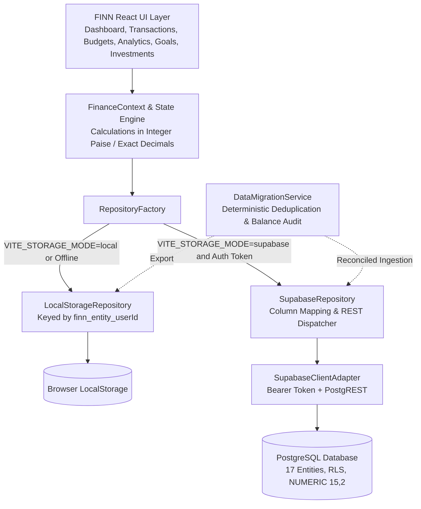
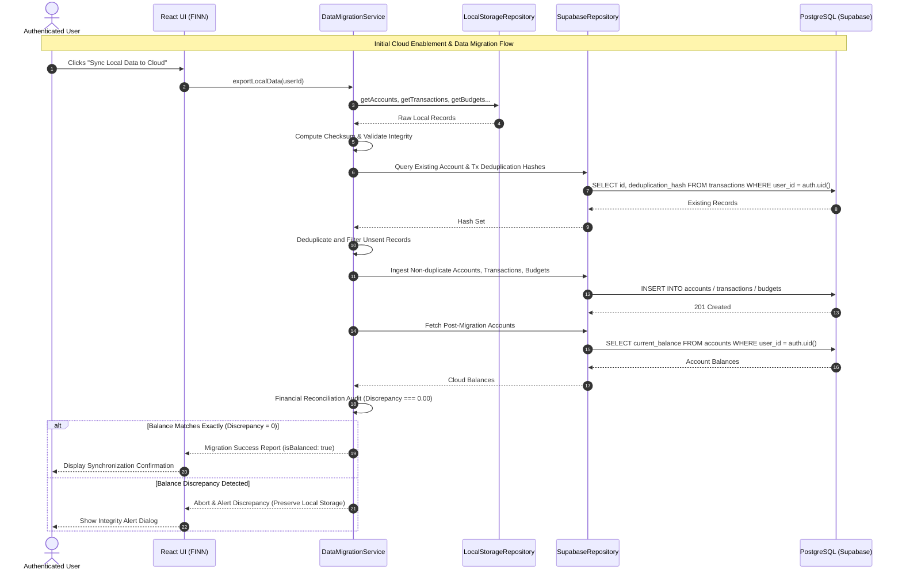

# PROJECT FINN — CLOUD ARCHITECTURE SPECIFICATION
**Document ID:** FINN-ARCH-002  
**Target Architecture:** Multi-Tenant Hybrid Local-First & PostgreSQL/Supabase Cloud  
**Engineered By:** Principal Full-Stack Architect & Fintech Backend Engineer  
**Status:** Architecture Prepared & Repository Layer Implemented  
**Date:** October 31, 2026  

---

## 1. Executive Summary

Project FINN is transitioning from a standalone browser-local personal finance application to a multi-tenant, cloud-enabled fintech platform backed by PostgreSQL and Supabase. 

To preserve 100% uninterrupted local operation, privacy, and zero data loss for existing users, FINN employs a **Pluggable Hybrid Repository Pattern**. The application core remains decoupled from storage primitives. When unauthenticated or when cloud credentials are unconfigured, FINN operates seamlessly in high-speed, local-first mode. When an authenticated user connects to the cloud backend, FINN orchestrates atomic, deduplicated data synchronization with full financial balance reconciliation.

---

## 2. Architectural Blueprint & Layer Separation



---

## 3. Pluggable Data Access Layer (Repository Pattern)

FINN defines a universal interface contract, `FinanceRepository`, decoupling domain services and UI components from underlying storage engines:

```typescript
export interface FinanceRepository {
  // Accounts
  getAccounts(userId: string): Promise<Account[]>;
  saveAccounts(userId: string, accounts: Account[]): Promise<RepositoryResult<Account[]>>;
  addAccount(userId: string, account: Account): Promise<RepositoryResult<Account>>;
  updateAccount(userId: string, accountId: string, updates: Partial<Account>): Promise<RepositoryResult<Account>>;
  deleteAccount(userId: string, accountId: string): Promise<RepositoryResult<void>>;

  // Transactions
  getTransactions(userId: string): Promise<Transaction[]>;
  saveTransactions(userId: string, transactions: Transaction[]): Promise<RepositoryResult<Transaction[]>>;
  addTransaction(userId: string, transaction: Transaction): Promise<RepositoryResult<Transaction>>;
  updateTransaction(userId: string, transactionId: string, updates: Partial<Transaction>): Promise<RepositoryResult<Transaction>>;
  deleteTransaction(userId: string, transactionId: string): Promise<RepositoryResult<void>>;

  // Budgets, Savings Goals, Holdings, Bill Splits
  getBudgets(userId: string): Promise<Budget[]>;
  getGoals(userId: string): Promise<SavingsGoal[]>;
  getHoldings(userId: string): Promise<Holding[]>;
  getSplitExpenses(userId: string): Promise<SplitExpense[]>;
  clearUserData(userId: string): Promise<RepositoryResult<void>>;
}
```

### 3.1 LocalStorageRepository
- **Implementation:** `src/services/storage/LocalStorageRepository.ts`
- **Isolation Mechanism:** Enforces strict user isolation using composite keys: `finn_${entity}_${userId}`.
- **Defensive Error Handling:** Uses `try/catch` JSON parsing with safe fallbacks and atomic in-memory state preservation in the event of browser quota errors.

### 3.2 SupabaseRepository
- **Implementation:** `src/services/storage/SupabaseRepository.ts`
- **Relational Transformation:** Automatically maps camelCase frontend entities to PostgreSQL snake_case tables and converts string decimal representations (`NUMERIC(15, 2)`) to verified floating or integer monetary numbers.
- **Tenant Enforcement:** Embeds `user_id: userId` in all payload bodies and queries, verified by PostgreSQL Row Level Security (RLS) policies.

### 3.3 RepositoryFactory & Fallback Engine
- **Implementation:** `src/services/storage/RepositoryFactory.ts`
- **Operational Principle:**
  1. Inspects explicit override (useful for integration tests or sandbox mode).
  2. Inspects `VITE_STORAGE_MODE` environment variable.
  3. Checks `isSupabaseConfigured()`.
  4. If `VITE_SUPABASE_URL` or `VITE_SUPABASE_ANON_KEY` is missing or invalid, **automatically falls back to `LocalStorageRepository`**.
  5. Guarantees 0% crashes for local and offline users.

---

## 4. Cloud Data Flow & Synchronization Lifecycle



---

## 5. Architectural Component Status Matrix

| Component | Architecture Role | Target Technology | Status | Verification Evidence |
| :--- | :--- | :--- | :--- | :--- |
| **Pluggable Repository Interface** | Abstraction Contract | TypeScript Interface | `Implemented` | `src/services/storage/FinanceRepository.ts` |
| **LocalStorage Repository** | Local-First Storage | Browser WebStorage | `Implemented` | Verified via 24 test suites & unit tests |
| **Supabase Client Adapter** | PostgREST & Auth Client | Fetch API / PostgREST | `Implemented` | `src/services/supabaseClient.ts` |
| **Supabase Storage Repository** | Cloud Ingestion & Query | Supabase REST | `Implemented` | `src/services/storage/SupabaseRepository.ts` |
| **Repository Factory** | Storage Resolution & Fallback | Factory Pattern | `Implemented` | `src/services/storage/RepositoryFactory.ts` |
| **Data Migration Service** | Export, Deduplicate, Ingest | FNV-1a Hash + Reconcile | `Implemented` | `src/services/migration/DataMigrationService.ts` |
| **PostgreSQL Schema (17 Tables)** | Cloud Relational Engine | PostgreSQL 15+ | `Prepared` | `supabase/migrations/00002_cloud_architecture_schema.sql` |
| **Row Level Security (RLS)** | Multi-Tenant Data Isolation | Postgres RLS Policies | `Prepared` | Full SQL definitions in migration 00002 |
| **Real Supabase Cloud Instance** | Remote Production DB | Supabase Cloud | `Blocked` | Requires external user project URL & keys |

---

## 6. Financial Integrity Invariants

1. **Exact Decimal Preservation:** The cloud database strictly uses `NUMERIC(15, 2)` for currency balances and transaction amounts, and `NUMERIC(18, 4)` for investment share quantities and currency exchange rates. Floating point types (`FLOAT`, `REAL`, `DOUBLE PRECISION`) are prohibited.
2. **Zero Ingestion Overcounting:** Every record ingested into Supabase computes a deterministic deduplication hash (`SHA256` or `FNV-1a(account + date + amount + merchant)`). Re-executing a migration will never double-count transactions or account balances.
3. **Reconciliation Audit Gate:** No migration is marked successful unless the pre-migration net balance of all accounts matches the post-migration remote sum with zero discrepancy (`Math.abs(pre - post) < 0.01`).
4. **Non-Destructive Local Fallback:** Under no circumstance will local storage data be wiped or modified if cloud ingestion fails, network disconnects, or balance reconciliation detects an anomaly.
