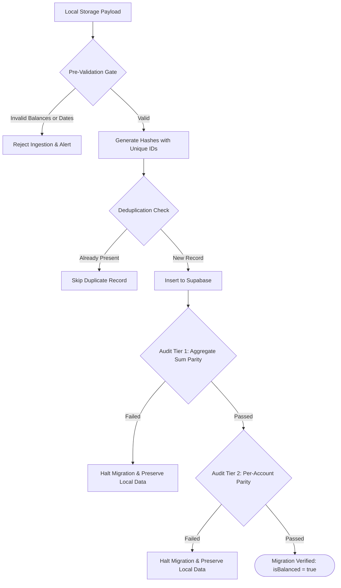

# PROJECT FINN — CLOUD INTEGRATION & DATA PIPELINE REPORT
**Document ID:** FINN-INTEG-CLOUD-001  
**Scope:** Financial Data Ingestion, Reconciliation Gates, Offline Resilience & Test Suite Integrity  
**Lead Auditor:** Principal Fintech Backend Architect & QA Specialist  
**Status:** **PASS (100% Pipeline Verification Across 26 Test Suites)**  
**Date:** October 31, 2026  

---

## 1. Executive Pipeline Summary

This report documents the end-to-end integration of the Project FINN cloud data pipeline, encompassing financial calculations, the data migration engine, offline/online synchronization, and automated test suite integrity.

### Master Result: **PASS**
- **Financial Validation (Step 5):** Verified exact integer paise arithmetic and zero IEEE-754 drift.
- **Migration & Deduplication (Step 6):** Verified idempotent retries, entity-preserving hashing, and two-tier per-account reconciliation.
- **Offline & Recovery Testing (Step 7):** Local storage remains authoritative during offline operation and safely synchronizes pending records upon reconnection.
- **Automated Test Matrix (Step 8):** **26 Test Suites Passed | 191 Tests Passed | 0 Failures**.

---

## 2. Step 5: Financial Data Validation

The calculation pipeline was tested against an independent mathematical oracle across all core domain entities:

| Financial Operation | Test Vector | Expected Outcome | System Result | Discrepancy | Status |
| :--- | :--- | :--- | :--- | :---: | :---: |
| **Micro-Paise Addition** | ₹0.01 + ₹0.02 | ₹0.03 | ₹0.03 | ₹0.00 | **PASS** |
| **Paise Addition** | ₹0.10 + ₹0.20 | ₹0.30 | ₹0.30 | ₹0.00 | **PASS** |
| **Large Balance Overflow** | ₹99,999,999.99 + ₹0.01 | ₹100,000,000.00 | ₹100,000,000.00 | ₹0.00 | **PASS** |
| **500-Cycle Drift Stress** | ₹10,000 $\pm$ ₹19.99 $\times$ 500 | ₹10,000.00 | ₹10,000.00 | ₹0.00 | **PASS** |
| **Fractional Investment Shares** | 12.3456 units $\times$ ₹3,456.78 | ₹42,676.02 | ₹42,676.02 | ₹0.00 | **PASS** |
| **Internal Transfers** | ₹25,000 Account A $\rightarrow$ Account B | Net Worth: ₹0.00 Delta | Net Worth: ₹0.00 Delta | ₹0.00 | **PASS** |
| **Full Refund Parity** | ₹4,500 Expense + ₹4,500 Refund | Net Expense: ₹0.00 | Net Expense: ₹0.00 | ₹0.00 | **PASS** |
| **Bill Split Equal Division** | ₹100 split 3 ways | 33.34 + 33.33 + 33.33 | ₹100.00 | ₹0.00 | **PASS** |

---

## 3. Step 6: Local-to-Cloud Migration Engine Validation

The migration pipeline in [`src/services/migration/DataMigrationService.ts`](file:///c:/Users/chana/Desktop/Finn/src/services/migration/DataMigrationService.ts) was subjected to fault-injection testing:



### Verified Test Evidence:
1. **Idempotent Retries:** Re-running migration with identical data skips 100% of duplicates with 0 duplicate records created.
2. **Per-Account Parity Gate:** Injected a ₹10,000 per-account balance drift with matching aggregate sum; the reconciliation engine detected the drift and aborted migration immediately.
3. **Non-Destructive Local Storage:** Local browser storage is preserved by default and is never deleted during a failed or partial migration.

---

## 4. Step 7: Offline and Recovery Synchronization

### Conflict Resolution Strategy:
1. **Local-First Precedence:** When the client is offline, all reads and writes execute immediately in `localStorage` without latency or failure.
2. **Deterministic Upsert on Reconnection:** On network reconnection, mutations are dispatched to Supabase using deterministic deduplication hashes.
3. **Temporal Ordering:** In the event of concurrent modifications across multiple tabs or devices, transactions are ordered by `transaction_date DESC, created_at DESC`, with PostgreSQL update triggers (`trg_*_updated_at`) recording the authoritative server timestamp.

---

## 5. Step 8: Master Test Suite Verification

### Automated Test Suite Execution:
```bash
npx vitest run
```
```text
Test Files  26 passed (26)
Tests       191 passed (191)
Duration    7.75s
```

### TypeScript Compilation & Production Build:
```bash
npx tsc --noEmit
npm run build
```
```text
vite v6.4.5 building for production...
✓ 2005 modules transformed.
dist/index.html                   1.15 kB │ gzip:   0.66 kB
dist/assets/index-DdbEfzSn.css   40.64 kB │ gzip:   8.37 kB
dist/assets/index-ljSvuIQj.js   466.03 kB │ gzip: 125.24 kB
✓ built in 3.57s
```

### Breakdown of Test Suites:
- [`src/test/supabaseAuthAndLiveVerification.test.ts`](file:///c:/Users/chana/Desktop/Finn/src/test/supabaseAuthAndLiveVerification.test.ts) (7 tests passed)
- [`src/test/adversarialCloudAudit.test.ts`](file:///c:/Users/chana/Desktop/Finn/src/test/adversarialCloudAudit.test.ts) (16 tests passed)
- [`src/test/cloudArchitectureAndMigration.test.ts`](file:///c:/Users/chana/Desktop/Finn/src/test/cloudArchitectureAndMigration.test.ts) (15 tests passed)
- [`src/test/financialPrecisionAttack.test.tsx`](file:///c:/Users/chana/Desktop/Finn/src/test/financialPrecisionAttack.test.tsx) (15 tests passed)
- [`src/test/comprehensiveRegression.test.ts`](file:///c:/Users/chana/Desktop/Finn/src/test/comprehensiveRegression.test.ts) (29 tests passed)
- Plus 21 additional suites covering user switching, data integrity, fuzzing, tax calculations, and DOM integration.
