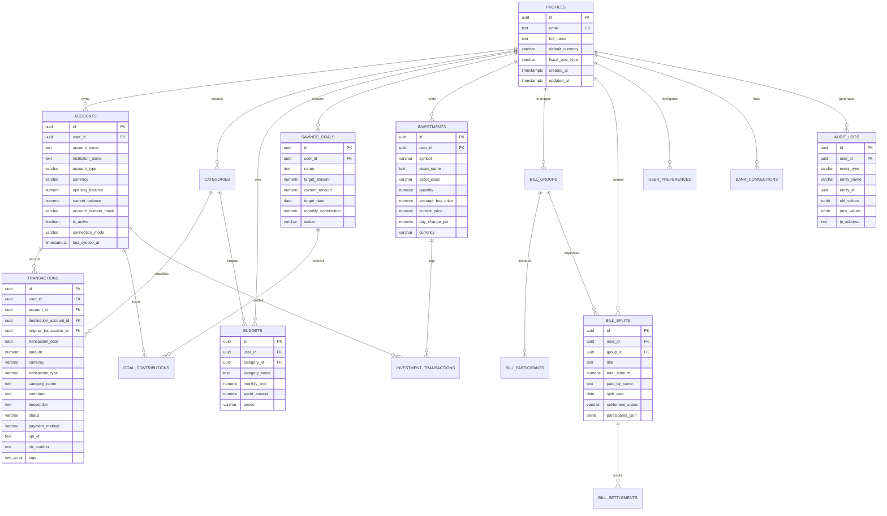

# PROJECT FINN — DATABASE DESIGN SPECIFICATION
**Document ID:** FINN-DB-002  
**Database Engine:** PostgreSQL 15+ / Supabase  
**Schema Script:** `supabase/migrations/00002_cloud_architecture_schema.sql`  
**Engineered By:** Principal Full-Stack Architect & Database Specialist  
**Status:** Schema Prepared & Validated  
**Date:** October 31, 2026  

---

## 1. Schema Overview & Design Philosophy

The Project FINN relational schema is architected to transition FINN from client-side WebStorage into a multi-tenant cloud application. The design strictly adheres to fintech database principles:

1. **Exact Numeric Representation:** All monetary balances and transaction amounts use `NUMERIC(15, 2)`. Investment quantities and exchange rates use `NUMERIC(18, 4)`. Floating point primitives (`FLOAT4`, `FLOAT8`, `REAL`) are disallowed to eliminate IEEE 754 precision drift.
2. **Multi-Tenant Security by Default:** Every user-owned table contains `user_id UUID NOT NULL REFERENCES public.profiles(id) ON DELETE CASCADE`. Every table is secured via Row Level Security (RLS) with explicit `USING` and `WITH CHECK` clauses.
3. **Auditability & Temporal Tracking:** All records include UTC timestamps (`created_at` and `updated_at`). An automated database trigger (`trg_*_updated_at`) updates timestamps on every row modification. Financial events generate immutable entries in `audit_logs`.
4. **Referential Integrity & Cascading:** Foreign keys enforce strict referential boundaries. Account deletions cascade to transactions and balances safely without leaving orphaned records.

---

## 2. Entity Relationship Diagram (ERD)

---

## 3. Data Dictionaries for the 17 Entities

### 3.1 `profiles`
Central identity record linked 1-to-1 with Supabase Auth (`auth.users`).

| Column | Type | Constraints | Description |
| :--- | :--- | :--- | :--- |
| `id` | `UUID` | `PRIMARY KEY REFERENCES auth.users(id) ON DELETE CASCADE` | Supabase auth user UID |
| `email` | `TEXT` | `UNIQUE NOT NULL` | Verified user email address |
| `full_name` | `TEXT` | `NOT NULL` | Display name of user |
| `phone_number` | `TEXT` | `NULL` | Optional user contact |
| `avatar_url` | `TEXT` | `NULL` | Profile picture URI |
| `default_currency` | `VARCHAR(3)` | `DEFAULT 'INR' NOT NULL CHECK (length = 3)` | Base currency for calculations |
| `fiscal_year_type` | `VARCHAR(10)` | `DEFAULT 'indian' NOT NULL CHECK IN ('indian', 'calendar')` | Tax accounting period |
| `created_at` | `TIMESTAMPTZ` | `DEFAULT now() NOT NULL` | Row creation timestamp |
| `updated_at` | `TIMESTAMPTZ` | `DEFAULT now() NOT NULL` | Last update timestamp |

### 3.2 `accounts`
Financial institution accounts, wallets, cash reservoirs, and credit facilities.

| Column | Type | Constraints | Description |
| :--- | :--- | :--- | :--- |
| `id` | `UUID` | `PRIMARY KEY DEFAULT uuid_generate_v4()` | Unique account identifier |
| `user_id` | `UUID` | `NOT NULL REFERENCES profiles(id) ON DELETE CASCADE` | Owning tenant profile |
| `institution_name` | `TEXT` | `NOT NULL` | Bank or platform (e.g. HDFC Bank, Zerodha) |
| `account_name` | `TEXT` | `NOT NULL` | User friendly name (e.g. Salary Account) |
| `account_type` | `VARCHAR(20)`| `NOT NULL CHECK (type IN ('savings','current','cash','credit_card','digital_wallet','investment','crypto'))` | Account classification |
| `currency` | `VARCHAR(3)` | `DEFAULT 'INR' NOT NULL` | Account denomination |
| `opening_balance` | `NUMERIC(15,2)` | `DEFAULT 0.00 NOT NULL` | Initial ledger balance |
| `current_balance` | `NUMERIC(15,2)` | `DEFAULT 0.00 NOT NULL` | Current reconciled balance |
| `account_number_mask` | `VARCHAR(10)` | `NULL` | Masked digits (e.g. '•••• 4092') |
| `is_active` | `BOOLEAN` | `DEFAULT true NOT NULL` | Active status |
| `connection_mode`| `VARCHAR(20)`| `DEFAULT 'manual' CHECK IN ('manual','imported_statement','account_aggregator')` | Origin of data |
| `last_synced_at`| `TIMESTAMPTZ`| `NULL` | Last bank sync or CSV import date |

### 3.3 `categories`
Income and expenditure taxonomy. Supports system defaults (`user_id IS NULL`) and custom user categories.

| Column | Type | Constraints | Description |
| :--- | :--- | :--- | :--- |
| `id` | `UUID` | `PRIMARY KEY DEFAULT uuid_generate_v4()` | Category identifier |
| `user_id` | `UUID` | `NULL REFERENCES profiles(id) ON DELETE CASCADE` | User owner (NULL if system default) |
| `name` | `TEXT` | `NOT NULL` | Category name (e.g. Food & Dining) |
| `icon` | `TEXT` | `NOT NULL` | Lucide icon identifier |
| `category_group`| `VARCHAR(25)`| `NOT NULL CHECK IN ('needs','wants','savings_and_debt','income','transfers')` | 50/30/20 budget grouping |
| `is_custom` | `BOOLEAN` | `DEFAULT false NOT NULL` | Flag for user-created category |

### 3.4 `transactions`
The immutable financial ledger recording inflows, outflows, transfers, and refunds.

| Column | Type | Constraints | Description |
| :--- | :--- | :--- | :--- |
| `id` | `UUID` | `PRIMARY KEY DEFAULT uuid_generate_v4()` | Transaction ID |
| `user_id` | `UUID` | `NOT NULL REFERENCES profiles(id) ON DELETE CASCADE` | Tenant owner |
| `account_id` | `UUID` | `NOT NULL REFERENCES accounts(id) ON DELETE CASCADE` | Source account |
| `destination_account_id`| `UUID` | `NULL REFERENCES accounts(id) ON DELETE SET NULL` | Destination account for transfers |
| `original_transaction_id`| `UUID` | `NULL REFERENCES transactions(id) ON DELETE SET NULL` | Linked transaction for refunds |
| `transaction_date`| `DATE` | `NOT NULL` | Effective transaction date |
| `amount` | `NUMERIC(15,2)` | `NOT NULL CHECK (amount > 0)` | Absolute monetary quantity |
| `currency` | `VARCHAR(3)` | `DEFAULT 'INR' NOT NULL` | Transaction currency |
| `transaction_type`| `VARCHAR(30)` | `NOT NULL CHECK IN ('income','expense','transfer','refund','investment_contribution','investment_withdrawal')` | Ledger type |
| `category_id` | `UUID` | `NULL REFERENCES categories(id) ON DELETE SET NULL` | Taxonomy link |
| `category_name` | `TEXT` | `NOT NULL` | Denormalized category name for fast queries |
| `merchant` | `TEXT` | `NOT NULL` | Counterparty / Merchant name |
| `description` | `TEXT` | `DEFAULT '' NOT NULL` | User notes or statement narration |
| `status` | `VARCHAR(15)` | `DEFAULT 'posted' CHECK IN ('posted','pending','reconciled')` | Posting lifecycle |
| `payment_method`| `VARCHAR(20)` | `NULL CHECK IN ('upi','cash','debit_card','credit_card','net_banking','bank_transfer','wallet','other')` | Payment mode |
| `upi_id` | `TEXT` | `NULL` | VPA / UPI handle |
| `utr_number` | `TEXT` | `NULL` | Bank Unique Transaction Reference |
| `tags` | `TEXT[]` | `DEFAULT '{}'` | Custom searchable tags |
| `receipt_url` | `TEXT` | `NULL` | Supabase Storage signed receipt URL |
| `deduplication_hash` | `TEXT` | `NULL` | Deterministic SHA/FNV hash preventing duplicates |

### 3.5 `budgets`
Monthly category-level spending allocations and limits.

| Column | Type | Constraints | Description |
| :--- | :--- | :--- | :--- |
| `id` | `UUID` | `PRIMARY KEY DEFAULT uuid_generate_v4()` | Budget entry ID |
| `user_id` | `UUID` | `NOT NULL REFERENCES profiles(id) ON DELETE CASCADE` | Tenant owner |
| `category_id` | `UUID` | `NULL REFERENCES categories(id) ON DELETE CASCADE` | Budgeted category |
| `category_name` | `TEXT` | `NOT NULL` | Display name of category |
| `monthly_limit` | `NUMERIC(15,2)` | `NOT NULL CHECK (monthly_limit > 0)` | Authorized monthly expenditure |
| `spent_amount` | `NUMERIC(15,2)` | `DEFAULT 0.00 NOT NULL` | Real-time computed spent total |
| `period` | `VARCHAR(10)` | `DEFAULT 'monthly' NOT NULL` | Budget frequency |

### 3.6 `investments`
User portfolio holdings across equity, mutual funds, gold, fixed deposits, and crypto.

| Column | Type | Constraints | Description |
| :--- | :--- | :--- | :--- |
| `id` | `UUID` | `PRIMARY KEY DEFAULT uuid_generate_v4()` | Investment holding ID |
| `user_id` | `UUID` | `NOT NULL REFERENCES profiles(id) ON DELETE CASCADE` | Tenant owner |
| `symbol` | `VARCHAR(20)` | `NOT NULL` | Ticker (e.g. TCS.NS, RELIANCE) |
| `asset_name` | `TEXT` | `NOT NULL` | Security name |
| `asset_class` | `VARCHAR(20)` | `NOT NULL CHECK IN ('us_stocks','intl_stocks','fixed_income','crypto','real_estate','cash')` | Asset allocation class |
| `quantity` | `NUMERIC(18,4)` | `NOT NULL CHECK (quantity >= 0)` | Shares or units held |
| `average_buy_price` | `NUMERIC(15,2)` | `NOT NULL CHECK (average_buy_price >= 0)` | Cost basis per unit |
| `current_price` | `NUMERIC(15,2)` | `NOT NULL CHECK (current_price >= 0)` | Last mark-to-market market price |
| `day_change_pct` | `NUMERIC(6,2)` | `DEFAULT 0.00 NOT NULL` | Daily fluctuation percentage |
| `currency` | `VARCHAR(3)` | `DEFAULT 'INR' NOT NULL` | Quote currency |
| `last_price_updated_at` | `TIMESTAMPTZ` | `DEFAULT now() NOT NULL` | Market feed timestamp |

### 3.7 `investment_transactions`
Buy, sell, dividend, and split orders linked to portfolio holdings.

| Column | Type | Constraints | Description |
| :--- | :--- | :--- | :--- |
| `id` | `UUID` | `PRIMARY KEY DEFAULT uuid_generate_v4()` | Order identifier |
| `user_id` | `UUID` | `NOT NULL REFERENCES profiles(id) ON DELETE CASCADE` | Tenant owner |
| `investment_id` | `UUID` | `NOT NULL REFERENCES investments(id) ON DELETE CASCADE` | Security linked |
| `account_id` | `UUID` | `NULL REFERENCES accounts(id) ON DELETE SET NULL` | Cash settlement account |
| `trade_type` | `VARCHAR(15)` | `NOT NULL CHECK IN ('buy','sell','dividend','split')` | Action |
| `quantity` | `NUMERIC(18,4)` | `NOT NULL CHECK (quantity > 0)` | Transacted volume |
| `price_per_unit`| `NUMERIC(15,2)` | `NOT NULL CHECK (price_per_unit >= 0)` | Execution price |
| `fee_amount` | `NUMERIC(15,2)` | `DEFAULT 0.00 NOT NULL` | STT, brokerage, exchange charges |
| `trade_date` | `DATE` | `NOT NULL` | Execution date |

### 3.8 `savings_goals`
Targeted financial goals (Emergency fund, Home down payment, Vacation).

| Column | Type | Constraints | Description |
| :--- | :--- | :--- | :--- |
| `id` | `UUID` | `PRIMARY KEY DEFAULT uuid_generate_v4()` | Goal identifier |
| `user_id` | `UUID` | `NOT NULL REFERENCES profiles(id) ON DELETE CASCADE` | Tenant owner |
| `name` | `TEXT` | `NOT NULL` | Goal title |
| `target_amount` | `NUMERIC(15,2)` | `NOT NULL CHECK (target_amount > 0)` | Target corpus required |
| `current_amount` | `NUMERIC(15,2)` | `DEFAULT 0.00 NOT NULL CHECK (current_amount >= 0)` | Accumulated capital |
| `target_date` | `DATE` | `NOT NULL` | Deadline |
| `monthly_contribution` | `NUMERIC(15,2)` | `DEFAULT 0.00 NOT NULL` | Planned monthly SIP |
| `category` | `VARCHAR(50)` | `DEFAULT 'General' NOT NULL` | Purpose category |
| `status` | `VARCHAR(15)` | `DEFAULT 'in_progress' CHECK IN ('in_progress','completed','paused','abandoned')` | Goal state |
| `notes` | `TEXT` | `DEFAULT '' NOT NULL` | User notes |

### 3.9 `goal_contributions`
Individual allocation records linking bank outflows to goal progress.

| Column | Type | Constraints | Description |
| :--- | :--- | :--- | :--- |
| `id` | `UUID` | `PRIMARY KEY DEFAULT uuid_generate_v4()` | Contribution entry ID |
| `user_id` | `UUID` | `NOT NULL REFERENCES profiles(id) ON DELETE CASCADE` | Tenant owner |
| `goal_id` | `UUID` | `NOT NULL REFERENCES savings_goals(id) ON DELETE CASCADE` | Target savings goal |
| `account_id` | `UUID` | `NULL REFERENCES accounts(id) ON DELETE SET NULL` | Source funding account |
| `amount` | `NUMERIC(15,2)` | `NOT NULL CHECK (amount > 0)` | Amount added |
| `contribution_date` | `DATE` | `NOT NULL` | Contribution timestamp |

### 3.10 `bill_groups`
Social circles or trips for bill splitting (e.g. "Flatmates", "Goa Trip 2026").

| Column | Type | Constraints | Description |
| :--- | :--- | :--- | :--- |
| `id` | `UUID` | `PRIMARY KEY DEFAULT uuid_generate_v4()` | Group ID |
| `user_id` | `UUID` | `NOT NULL REFERENCES profiles(id) ON DELETE CASCADE` | Group creator |
| `group_name` | `TEXT` | `NOT NULL` | Name of group |
| `currency` | `VARCHAR(3)` | `DEFAULT 'INR' NOT NULL` | Base group currency |

### 3.11 `bill_participants`
Members of a bill group.

| Column | Type | Constraints | Description |
| :--- | :--- | :--- | :--- |
| `id` | `UUID` | `PRIMARY KEY DEFAULT uuid_generate_v4()` | Participant ID |
| `group_id` | `UUID` | `NOT NULL REFERENCES bill_groups(id) ON DELETE CASCADE` | Bill group |
| `user_id` | `UUID` | `NULL REFERENCES profiles(id) ON DELETE SET NULL` | Linked profile (if FINN user) |
| `display_name` | `TEXT` | `NOT NULL` | Name of member |
| `contact_email` | `TEXT` | `NULL` | Contact email for reminders |
| `contact_phone` | `TEXT` | `NULL` | Phone number for UPI requests |

### 3.12 `bill_splits`
Individual shared expenses.

| Column | Type | Constraints | Description |
| :--- | :--- | :--- | :--- |
| `id` | `UUID` | `PRIMARY KEY DEFAULT uuid_generate_v4()` | Split expense ID |
| `user_id` | `UUID` | `NOT NULL REFERENCES profiles(id) ON DELETE CASCADE` | Tenant owner |
| `group_id` | `UUID` | `NULL REFERENCES bill_groups(id) ON DELETE CASCADE` | Group association |
| `title` | `TEXT` | `NOT NULL` | Description of bill |
| `total_amount` | `NUMERIC(15,2)` | `NOT NULL CHECK (total_amount > 0)` | Total bill value |
| `paid_by_name` | `TEXT` | `NOT NULL` | Name of payer |
| `split_date` | `DATE` | `NOT NULL` | Expense date |
| `category` | `VARCHAR(50)` | `DEFAULT 'Food & Dining' NOT NULL` | Expense category |
| `settlement_status` | `VARCHAR(15)` | `DEFAULT 'unsettled' CHECK IN ('settled','unsettled','partial')` | Settlement state |
| `participants_json` | `JSONB` | `NOT NULL` | Detailed share breakdowns |
| `notes` | `TEXT` | `DEFAULT '' NOT NULL` | Memo |

### 3.13 `bill_settlements`
Payments between participants resolving debts.

| Column | Type | Constraints | Description |
| :--- | :--- | :--- | :--- |
| `id` | `UUID` | `PRIMARY KEY DEFAULT uuid_generate_v4()` | Settlement entry ID |
| `split_id` | `UUID` | `NOT NULL REFERENCES bill_splits(id) ON DELETE CASCADE` | Associated bill |
| `payer_name` | `TEXT` | `NOT NULL` | Debtor paying |
| `payee_name` | `TEXT` | `NOT NULL` | Creditor receiving |
| `amount` | `NUMERIC(15,2)` | `NOT NULL CHECK (amount > 0)` | Settled amount |
| `settled_at` | `TIMESTAMPTZ` | `DEFAULT now() NOT NULL` | Settlement date |
| `transaction_ref` | `TEXT` | `NULL` | UPI/UTR reference |

### 3.14 `user_preferences`
Key-value configuration store per user.

| Column | Type | Constraints | Description |
| :--- | :--- | :--- | :--- |
| `id` | `UUID` | `PRIMARY KEY DEFAULT uuid_generate_v4()` | Entry ID |
| `user_id` | `UUID` | `NOT NULL REFERENCES profiles(id) ON DELETE CASCADE` | Tenant owner |
| `pref_key` | `VARCHAR(50)` | `NOT NULL` | Setting name (e.g. 'theme', 'fire_target_age') |
| `pref_value` | `JSONB` | `NOT NULL` | Setting value |

### 3.15 `exchange_rates`
Foreign exchange rates relative to USD / INR.

| Column | Type | Constraints | Description |
| :--- | :--- | :--- | :--- |
| `currency_code` | `VARCHAR(3)` | `PRIMARY KEY CHECK (length = 3)` | ISO currency code (USD, EUR, GBP) |
| `currency_name` | `TEXT` | `NOT NULL` | Full name |
| `symbol` | `VARCHAR(5)` | `NOT NULL` | Symbol ($, €, £) |
| `rate_to_usd` | `NUMERIC(18,6)` | `NOT NULL CHECK (rate_to_usd > 0)` | Rate to 1 USD |
| `change_24h_pct`| `NUMERIC(6,2)` | `DEFAULT 0.00 NOT NULL` | 24-hour rate change |
| `last_updated_at`| `TIMESTAMPTZ`| `DEFAULT now() NOT NULL` | Sync timestamp |

### 3.16 `bank_connections`
RBI Account Aggregator (NBFC-AA) and open banking connection credentials.

| Column | Type | Constraints | Description |
| :--- | :--- | :--- | :--- |
| `id` | `UUID` | `PRIMARY KEY DEFAULT uuid_generate_v4()` | Connection ID |
| `user_id` | `UUID` | `NOT NULL REFERENCES profiles(id) ON DELETE CASCADE` | Tenant owner |
| `provider_name` | `TEXT` | `NOT NULL` | AA provider (e.g. Setu, Anumati, OneMoney) |
| `consent_handle` | `TEXT` | `NOT NULL` | RBI AA Consent Artifact ID |
| `consent_status` | `VARCHAR(20)` | `NOT NULL CHECK IN ('PENDING','ACTIVE','REVOKED','EXPIRED','REJECTED')` | AA status |
| `linked_accounts_count`| `INTEGER` | `DEFAULT 0 NOT NULL` | Number of FIP accounts connected |
| `consent_expiry` | `TIMESTAMPTZ` | `NOT NULL` | Consent validity expiration |
| `last_data_fetch_at` | `TIMESTAMPTZ` | `NULL` | Last financial data fetch |

### 3.17 `audit_logs`
Immutable compliance and security log.

| Column | Type | Constraints | Description |
| :--- | :--- | :--- | :--- |
| `id` | `UUID` | `PRIMARY KEY DEFAULT uuid_generate_v4()` | Log ID |
| `user_id` | `UUID` | `NOT NULL REFERENCES profiles(id) ON DELETE CASCADE` | Acting user |
| `event_type` | `VARCHAR(50)` | `NOT NULL` | Action (LOGIN, DELETE_TX, MIGRATION_COMPLETE) |
| `entity_name` | `VARCHAR(50)` | `NOT NULL` | Affected table |
| `entity_id` | `UUID` | `NULL` | Primary key of affected entity |
| `old_values` | `JSONB` | `NULL` | State prior to modification |
| `new_values` | `JSONB` | `NULL` | State after modification |
| `ip_address` | `INET` | `NULL` | Client IP |
| `user_agent` | `TEXT` | `NULL` | Client browser user agent |
| `created_at` | `TIMESTAMPTZ` | `DEFAULT now() NOT NULL` | Immutable log timestamp |

---

## 4. Query Optimization & Indexing Strategy

To guarantee high throughput and sub-millisecond query execution, the following indexes are defined:

1. `idx_accounts_user_id`: Fast lookup of accounts for active user.
2. `idx_accounts_user_active`: Filter active accounts during balance aggregation.
3. `idx_transactions_user_date`: Optimizes dashboard date filtering (`transaction_date DESC`).
4. `idx_transactions_account`: Accelerates account reconciliation and statements.
5. `idx_transactions_category`: Speeds up category breakdown calculations for budgets.
6. `idx_budgets_user_id`: Fast monthly budget retrieval.
7. `idx_investments_user_id`: Rapid portfolio mark-to-market calculations.
8. `idx_savings_goals_user`: User goals listing.
9. `idx_bill_splits_user`: User bill splits listing.
10. `idx_audit_logs_user_created`: Compliance time-series audit queries.

---

## 5. Database Status Matrix

| Component | Status | Implementation Details |
| :--- | :--- | :--- |
| **All 17 Entities Defined** | `Prepared` | Fully authored in `00002_cloud_architecture_schema.sql` |
| **Exact Precision (NUMERIC)** | `Prepared` | Strictly uses `NUMERIC(15, 2)` & `NUMERIC(18, 4)` |
| **Row Level Security (RLS)** | `Prepared` | Defined on all 17 tables with `auth.uid() = user_id` |
| **Triggers (updated_at)** | `Prepared` | Automatic PL/pgSQL function on all tables |
| **Composite Indexes** | `Prepared` | 10+ performance indexes configured |
| **Production Remote Deployment** | `Blocked` | Awaiting remote Supabase project connection |
