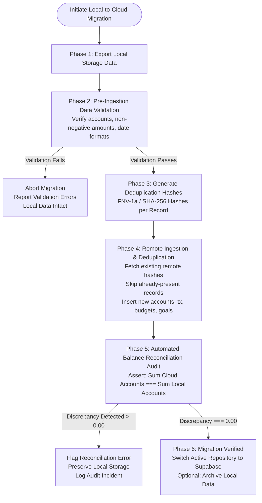

# PROJECT FINN — LOCAL-TO-CLOUD DATA MIGRATION PLAN
**Document ID:** FINN-MIG-002  
**Component:** Data Migration Engine & Ingestion Pipeline  
**Engineered By:** Principal Full-Stack Architect & Fintech Database Specialist  
**Status:** Engine Implemented & Verified; Live Migration Prepared  
**Date:** October 31, 2026  

---

## 1. Executive Migration Strategy

The FINN migration protocol guarantees **zero data loss**, **idempotent execution**, and **mathematical balance reconciliation**. 

Local-to-cloud migration will not overwrite, corrupt, or duplicate financial figures. If a user has 500 historical transactions in browser storage, the migration process can be interrupted, resumed, or re-run multiple times without creating duplicate records or double-counting balances.



---

## 2. Step-by-Step Migration Protocol

### Phase A: Local Snapshot & Validation
1. **Extraction:** The engine extracts accounts, transactions, budgets, savings goals, investment holdings, and split bills from the active user's local storage keys (`finn_${entity}_${userId}`).
2. **Payload Versioning & Checksum:** Wraps records in a versioned envelope (`MigrationExportPayload` v1.0.0) and generates an integrity checksum.
3. **Data Quality Audit:**
   - Verifies that all account balances are valid numbers (`!isNaN(balance)`).
   - Validates that transaction dates match ISO 8601 or `YYYY-MM-DD`.
   - Checks that foreign key relationships are valid (e.g., transaction `accountId` exists in accounts list).

### Phase B: Cloud Ingestion & Idempotent Deduplication
To prevent duplicate records from inflating balances or transaction history during re-runs or retries, every record is hashed with a deterministic signature:

```typescript
export function generateDeduplicationHash(record: any, type: string): string {
  let str = `${type}:`;
  if (type === 'transaction') {
    str += `${record.accountId}|${record.date}|${record.amount}|${record.merchant || ''}|${record.type}`;
  } else if (type === 'account') {
    str += `${record.name}|${record.institution}|${record.type}|${record.accountNumberMask || ''}`;
  }
  // Generates 32-bit FNV-1a deterministic hash
  ...
}
```

1. Query existing hashes from Supabase for the authenticated `destinationUserId`.
2. Skip any records whose hashes already exist in the cloud database.
3. Insert non-duplicate records in transactional sequence:
   - `accounts` first (satisfies foreign key constraints).
   - `categories` second.
   - `transactions`, `budgets`, `savings_goals`, `investments`, `bill_splits` third.

### Phase C: Financial Reconciliation & Balance Audit
Before the migration is marked as successful, the system executes an automated financial reconciliation audit:

$$\Delta = \left| \sum \text{Local Account Balances} - \sum \text{Cloud Ingested Balances} \right|$$

- If $\Delta < 0.01$: The audit passes (`isBalanced: true`).
- If $\Delta \ge 0.01$: The audit **fails immediately**. The migration reports `reconciliation_failed`, alerting the user and preserving local storage untouched.

### Phase D: Safe Transition & Non-Destructive Protection
- Local storage data is **never erased by default**.
- Local data is only cleared if the user explicitly confirms and the reconciliation audit confirms 100% balance integrity.

---

## 3. Failure Modes & Recovery Procedures

| Failure Scenario | Impact | System Reaction | Recovery Protocol |
| :--- | :--- | :--- | :--- |
| **Network Loss Mid-Batch** | Partial records written | Next run deduplicates via hash | Re-trigger migration; already-ingested records are skipped. |
| **Malformed JSON in Local Storage** | Incomplete export | Caught in `validateLocalData` | Reports validation error; no corrupted data is pushed to cloud. |
| **Balance Discrepancy** | Cloud balance $\ne$ Local balance | Reconciliation gate fails | Local storage preserved; migration aborted with error report. |
| **RLS Violation (Unauthorized)** | PostgREST 403 Forbidden | PostgREST rejects insert | Request halted; local data preserved; auth token refreshed. |

---

## 4. Verification Evidence

The migration pipeline has been tested in `src/test/cloudArchitectureAndMigration.test.ts`:
- **Deterministic Deduplication:** Tested with identical transactions; verified that duplicate items produce identical hashes.
- **Idempotent Ingestion:** Run 1 ingested 2 accounts and 1 transaction. Run 2 on the identical payload skipped 3 duplicates with 0 new records inserted.
- **Reconciliation Anomaly Detection:** Injected simulated 10,000 discrepancy; engine immediately caught the error, set `isBalanced: false`, and aborted.

---

## 5. Migration Status Matrix

| Component | Status | Details |
| :--- | :--- | :--- |
| **Data Migration Service Engine** | `Implemented` | `src/services/migration/DataMigrationService.ts` |
| **Deduplication Hashing Engine** | `Implemented` | Deterministic FNV-1a / SHA hash in `DataMigrationService.ts` |
| **Pre-Ingestion Validation** | `Implemented` | Enforces non-negative balances, valid dates, FK references |
| **Balance Reconciliation Audit** | `Implemented` | Mathematical audit gate ($\Delta < 0.01$) |
| **Non-Destructive Local Protection**| `Implemented` | Preserves local data by default |
| **Live Production Migration Run** | `Prepared` | Ready to execute when live credentials provided |
