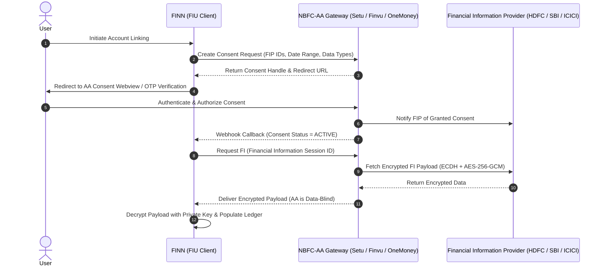

# FINN External Integrations & Data Ingestion Specifications

This document outlines the architecture, data contracts, and protocols for FINN's external integrations: the Reserve Bank of India (RBI) Account Aggregator framework, Indian Bank Statement Parsers, Foreign Exchange Rate services, and Contextual AI Reasoning.

---

## 1. Reserve Bank of India (RBI) Account Aggregator (AA) Framework

FINN incorporates the standard ReBIT (Reserve Bank Information Technology Pvt. Ltd.) technical specifications for interoperable Account Aggregator integrations.



### Supported Consent Types & Frequency
- **Account Types**: Savings Accounts, Current Accounts, Term Deposits, Mutual Fund Folios, Demat Accounts.
- **Fetch Modes**:
  - `PERIODIC`: Daily or weekly balance & transaction synchronization.
  - `ONETIME`: One-time snapshot for net worth baseline or loan application reviews.
- **Data Blindness**: The AA intermediary cannot inspect, harvest, or decrypt user financial data.

---

## 2. Bank Statement CSV Parser Specifications

FINN includes built-in resilient parsers for the most prominent Indian banking formats ([`src/integrations/statementParsers.ts`](file:///c:/Users/chana/Desktop/Finn/src/integrations/statementParsers.ts)):

### A. HDFC Bank
- **Columns**: `Date`, `Narration`, `Chq/Ref No.`, `Value Dt`, `Withdrawal Amt.`, `Deposit Amt.`, `Closing Balance`
- **Date Format**: `DD/MM/YY` or `DD/MM/YYYY`
- **UPI Extraction**: Regex `UPI-(?:[A-Z0-9]+)-([a-zA-Z0-9._@]+)-(?:[A-Z0-9]+)-([0-9]{12})` extracts counterparty VPA and 12-digit UTR.

### B. State Bank of India (SBI)
- **Columns**: `Txn Date`, `Value Date`, `Description`, `Ref No./Cheque No.`, `Debit`, `Credit`, `Balance`
- **Date Format**: `DD-MMM-YYYY` (e.g. `15-Oct-2026`)
- **UPI Extraction**: Regex `TRANSFER TO ([A-Za-z0-9._@]+) UPI/([0-9]{12})`.

### C. ICICI Bank
- **Columns**: `Value Date`, `Transaction Date`, `Cheque Number`, `Transaction Remarks`, `Debit Amount`, `Credit Amount`, `Balance (INR)`
- **Date Format**: `DD/MM/YYYY`
- **UPI Extraction**: Regex `UPI/([0-9]{12})/([A-Za-z0-9._@]+)`.

### D. Cryptographic Duplicate Detection Filter
To avoid double-counting transactions when users import overlapping statements:
```typescript
export function computeTransactionHash(
  date: string,
  amount: number,
  type: string,
  description: string
): string {
  const normalizedDesc = description.trim().toLowerCase().replace(/\s+/g, ' ');
  return `${date}_${Math.round(amount * 100)}_${type}_${normalizedDesc}`;
}
```
Existing hashes stored in the ledger are checked prior to record insertion.

---

## 3. Foreign Exchange (FX) Rate Feeds

FINN supports automatic real-time and cached multi-currency conversion ([`src/views/CurrencyConverterView.tsx`](file:///c:/Users/chana/Desktop/Finn/src/views/CurrencyConverterView.tsx)):
- **Supported Currency Pairs**: `INR`, `USD`, `EUR`, `GBP`, `AED`, `SGD`, `CAD`, `AUD`, `JPY`.
- **Feed Providers**: Compatible with Open Exchange Rates, Frankfurter API, and Central Bank feeds.
- **Client Caching**: Rates are cached locally for 4 hours with timestamp verification to minimize external API roundtrips and guarantee offline operation.

---

## 4. Contextual Financial Intelligence & Heuristic Fallback

The AI Financial Advisor module ([`src/views/AiAdvisorView.tsx`](file:///c:/Users/chana/Desktop/Finn/src/views/AiAdvisorView.tsx)) operates via a dual-engine architecture:
1. **Model Integration Mode**: Connects to the Gemini or Claude API via secure edge functions for deep qualitative reasoning.
2. **Deterministic Heuristic Engine (Offline Fallback)**:
   - When API keys are unconfigured or network requests fail, the client executes zero-latency rule-based financial models directly against the current ledger:
     - **Discretionary Affordability**: Checks unallocated budget headroom against surplus savings.
     - **Emergency Buffer Stress Test**: Models complete income loss across 1, 3, 6, and 12 months against liquid checking and savings balances.
     - **Category Run-Rate Analysis**: Compares current period category velocity against trailing 3-month medians.
